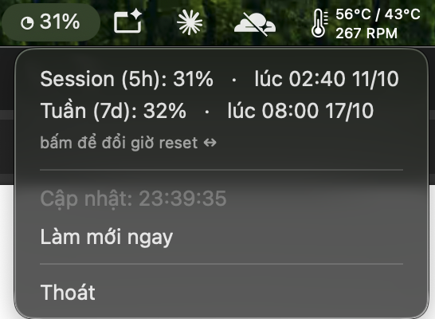

# Claude Usage Bar

A tiny cross-platform tray app that shows your **Claude usage** — the same numbers
as `claude.ai/settings/usage` — in your menu bar / system tray.

*Ứng dụng nhỏ hiển thị **% usage của Claude** (giống trang `claude.ai/settings/usage`)
ngay trên menu bar (macOS) hoặc system tray (Linux / Windows).*

<p align="center">
  
</p>

- **macOS** → percentage in the menu bar (`○ ◔ ◑ ◕ ●` fills as usage grows; turns
  **red** above 80%).
- **Linux / Windows** → a colored tray icon with the % (green → yellow → red);
  hover for details, right-click for the menu.
- **Click the Session / Week line** to toggle the reset time between relative
  (`còn 4h52m`) and absolute (`lúc 02:40 11/10`) — the menu stays open.

## How it works

Calls the same private endpoint the usage page uses:

```
GET https://claude.ai/api/organizations/{org_id}/usage
→ five_hour.utilization  (session 5h %)   +   seven_day.utilization  (weekly %)
```

Auth is automatic: it reads your `claude.ai` login cookie from your browser
(Chrome, Brave, Edge, Chromium, Vivaldi, Opera, Firefox, Safari) via
[`browser-cookie3`](https://github.com/borisbabic/browser_cookie3). Nothing leaves
your machine except the request to claude.ai. Refreshes every 30s.

## Requirements

- Python 3.9+
- Logged in to **claude.ai** in a supported browser
- **macOS**: nothing else
- **Linux**: a system tray (GTK / AppIndicator) — `run.sh` installs the needed
  packages automatically. On **GNOME** enable the
  [AppIndicator extension](https://extensions.gnome.org/extension/615/appindicator-support/).

## Quick start (one command)

```bash
git clone <your-repo-url> claude-usage-bar
cd claude-usage-bar
```

**macOS / Linux:**
```bash
./run.sh
```

**Windows** (double-click `run.bat`, or):
```bat
run.bat
```

All of these just call the cross-platform bootstrap `run.py`, which creates a
virtualenv, installs everything (including Linux system packages for the tray), and
launches the app. You can also call it directly on any OS: `python run.py`
(re-install deps with `python run.py --reinstall`).

> On macOS, the first run may ask for **Keychain** access (to read the browser
> cookie) — click **Always Allow**.

### Windows notes

- `run.bat` starts the app **in the background** (no console window) and closes itself
  after a few seconds. Look for the icon in the system tray — if it isn't visible,
  click the **`^`** arrow to show hidden icons. Quit from the icon's right-click menu
  (**Thoát**). Running `run.bat` again is safe: a second copy won't start.
  Errors go to `%TEMP%\claude-usage-bar.log`.
- **Number at the left of the taskbar.** Windows only allows tray icons in the
  notification area on the *right*, so the app can also show a small always-on-top
  **widget** instead: right-click the tray icon → tick **Hiện số ở góc taskbar**. It
  appears next to the weather widget at the taskbar's left, drawn straight onto the
  taskbar with no background: `✦ Session 33% ▬ | 📅 Week 69% ▬  ⌄`. The progress
  bars are blue/green normally, **yellow from 75%** and **red from 90%** (tune
  `WARN_AT` / `DANGER_AT` in `claude_usage_widget.py`).
  - **Click** it to open a details panel above the taskbar: *Chi tiết sử dụng token*
    (opens `claude.ai/settings/usage`), *Phiên hiện tại*, *Giới hạn tuần*, *Làm mới
    ngay* and *Cài đặt* (log in, paste a `sessionKey`, hide the widget, quit). Click
    the "Còn …" line to switch between time left and the exact reset time. Click
    anywhere outside to close it.
  - **Anchor** it: *Cài đặt → Điểm neo* in the panel (or right-click the widget, or the
    tray icon's **Điểm neo widget**) pins it to **bottom-left** (next to the weather
    widget, the default), **bottom-right** (just left of the system tray), **top-left**
    or **top-right**. While anchored it stays put — it re-positions itself if the
    taskbar or resolution changes — and the panel opens towards the screen's centre.
    Choose **Tự do** to drag it anywhere (the position is remembered).
  - It hides itself while a full-screen app is in front, and uses dark text on a
    light taskbar.
  Both the tray icon and the widget can be used together. Set
  `CLAUDE_USAGE_DEBUG=1` to log widget events (to the log file) when troubleshooting.
- The virtualenv lives in `.venv-win` (macOS/Linux use `.venv`), so one project folder
  can be shared between operating systems without the venvs clobbering each other.
- Very new Python versions (e.g. 3.15) have no prebuilt `lz4` wheel, and building it
  needs the MSVC Build Tools. `run.py` detects this and installs everything else
  without `lz4`; only Firefox *session* cookies are affected.
- **Chrome / Edge encrypt cookies with App-Bound Encryption**, so reading them needs
  an **Administrator** terminal. If you see *"Chrome/Edge cần quyền Admin…"*, either
  run `run.bat` from an elevated prompt, use Firefox, or paste your `sessionKey` once
  (see below).

**Easiest: log in from the app.** Right-click the tray icon → **Đăng nhập claude.ai…**.
A Chrome/Edge/Brave window opens on `claude.ai/login` using a *temporary profile* the
app creates (your real browser profile is not touched). Sign in however you like
(Google, email code…). As soon as you're signed in the app stores that session in
`config.json`, closes the window and deletes the temporary profile. Repeat it whenever
the session expires. (An email *link* opens in your default browser instead — use the
code, or Google sign-in, in that window.)

**Pasting `sessionKey` manually** (works on every OS): in your browser open
`claude.ai` → DevTools (F12) → *Application* (Chrome/Edge) or *Storage* (Firefox) →
*Cookies* → `https://claude.ai` → copy the value of `sessionKey`.

On Windows/Linux just right-click the tray icon → **Nhập sessionKey…** and paste it —
the app saves it and refreshes immediately. Or save it yourself to
`%USERPROFILE%\.config\claude-usage\config.json` (`~/.config/claude-usage/config.json`
elsewhere):

```json
{ "sessionKey": "sk-ant-sid01-..." }
```

Treat it like a password: it grants access to your Claude account. The file is only
read locally and is git-ignored. When the key expires, paste a fresh one.

## Start automatically at login

```bash
./scripts/install-startup.sh     # macOS: LaunchAgent · Linux: autostart .desktop
./scripts/uninstall-startup.sh   # remove
```

## Configuration (optional)

Everything is auto-detected. Create a config only to override something (e.g. cookie
reading fails, or you use multiple browsers):

```bash
mkdir -p ~/.config/claude-usage
cp config.example.json ~/.config/claude-usage/config.json   # then edit
```

| Field        | Purpose                                                             |
|--------------|---------------------------------------------------------------------|
| `browser`    | Force a browser (`chrome`, `brave`, `firefox`, …)                   |
| `sessionKey` | Paste the claude.ai `sessionKey` cookie manually                    |
| `org_id`     | Force an organization id (default: auto-picks your Claude plan org) |

Or via env: `CLAUDE_USAGE_BROWSER=brave ./run.sh`.

Change the refresh interval by editing `POLL_SECONDS` at the top of `claude_usage_app.py`.

## Project layout

| File | Role |
|------|------|
| `claude_usage_core.py` | cookie + API + formatting (platform-independent) |
| `claude_usage_app.py`  | entry point — picks rumps (macOS) or pystray (Linux/Windows) |
| `claude_usage_login.py`| in-app login window (temporary Chrome/Edge profile → saves the session) |
| `claude_usage_widget.py`| floating number widget on the taskbar's left (Windows/Linux tray build) |
| `run.py`               | cross-platform bootstrap (venv + deps + launch) |
| `run.sh` / `run.bat`   | thin launchers → `run.py` (Unix / Windows) |
| `scripts/*.sh`         | install / uninstall autostart |

## Troubleshooting

- **Shows `⚠︎` / "lỗi"** — you're probably not logged in to claude.ai, or the cookie
  expired → log in again in your browser.
- **`HTTP 401/403`** — `sessionKey` expired; re-login.
- **Can't read cookie** — set `"browser"` in the config, or paste `sessionKey`.
- **Linux: no tray icon** — install/enable an AppIndicator tray (GNOME needs the
  extension above; KDE/XFCE/Cinnamon work out of the box).
- **Logs** — `/tmp/claude-usage-bar.log` (when started via autostart).

## Privacy

Talks only to `claude.ai` using your existing browser session. Your cookie never
leaves your machine. Don't commit your `config.json` — it's gitignored.

## Contributing

Contributions welcome — open an issue or PR. By submitting a contribution you agree
it is licensed to the project under the same license below.

## License

Licensed under the **[PolyForm Noncommercial License 1.0.0](LICENSE)**.

You may use, modify, and share this software for **any noncommercial purpose**
(personal projects, study, research, nonprofit / educational / government use).
**Commercial or business use is not permitted.** This is a *source-available*
license, not an OSI "open source" license — intentional, so the code stays free to
contribute to but not to be used commercially. Need a commercial license? Open an issue.
